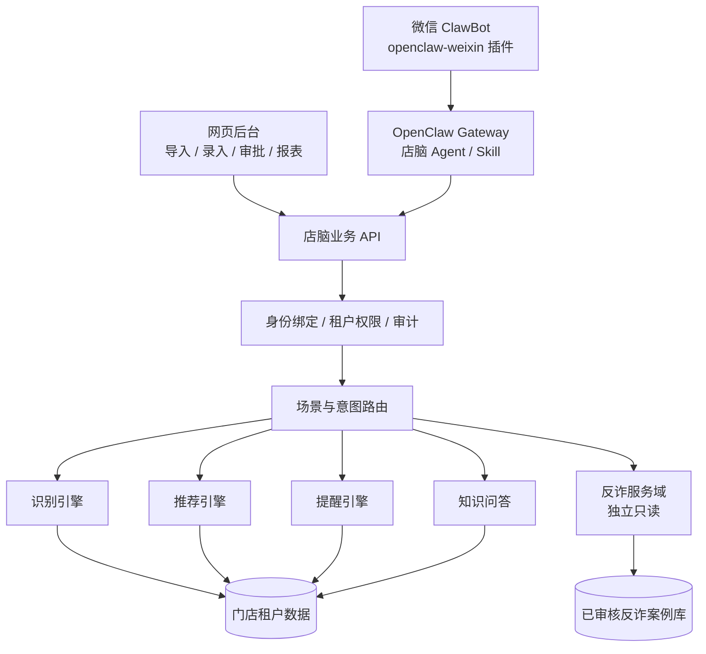

# 店脑 DIANNAO

> **福州黑客松参赛项目**

门店客户记忆与经验管理系统 · 微信 ClawBot + 网页工作台双入口


---

## 产品定位

店脑面向以「老客服务」为核心的门店（母婴、服装、美妆等），将分散在店员个人经验中的客户偏好、购买记录与服务历史，沉淀为门店可追溯、可审核、可撤权的结构化数据资产，并通过微信与网页两个入口支撑日常接待。

产品由一套行业无关的核心引擎、多个行业配置包、两条相互隔离的服务域和两种入口构成。

## 产品概览


## 需求背景


| 现状 | 后果 |
|---|---|
| 老客资料记在店员个人记忆、微信聊天记录与纸质台账中 | 店员离职即造成信息断层，老客体验不可延续 |
| 资深店员的判断标准无法复制 | 新人上手周期长，推荐依赖个人经验 |
| 客户资料分散、缺乏授权边界 | 数据可见范围失控，发生问题无法追溯 |
| 老年顾客受骗风险高，店员缺乏提示依据 | 该提示时无据可依，服务价值受损 |

## 差异化定位


与其他通用 AI 方案的差异体现在数据来源与服务闭环，而非模型能力本身：

- 通用 AI 需由用户提供客户背景；店脑先完成客户识别再应答，支持姓名与尾号脱敏核验。
- 通用 AI 依赖外部知识库；店脑的事实来自门店自身的服务历史，无记录即明确告知无记录。
- 通用 AI 的对话不具备沉淀能力；店脑将每次接待转化为草稿、审核、正式档案的三段式流程。
- 通用 AI 不区分租户；店脑实现多店数据隔离，人员离职后权限即时失效。

## 产品界面

### 微信端接待

店员无需安装独立应用，在微信对话中即可查询客户历史购买、家庭成员信息与服务注意事项，回答附带来源依据。


### 后台账号绑定

后台生成六位绑定码，店员通过个人微信向「店脑 ClawBot」提交后完成身份绑定，此后查询与录入均限定在所属门店范围。


店员侧绑定说明与调用入口：


### 草稿审核

微信端的「记录本次服务」「更新客户画像」均先进入待审核区，经店长确认后方写入正式档案；驳回不影响已有数据。


## 核心能力

- **客户识别**：确定性索引优先，配合候选消歧；先识别客户再应答，无记录时明确告知，不生成推测内容。
- **经验沉淀**：微信端单句录入、草稿区暂存、店长审核、正式归档，全过程记录来源与操作人。
- **接待支持**：基于硬规则过滤与商品、经验召回生成建议，结论须给出可追溯依据。
- **反诈服务（独立域）**：仅读取经审核的官方反诈案例库（含 96110 等来源），与商家客户数据物理隔离。
- **多租户隔离**：门店数据相互独立，跨店访问返回 404；权限撤销后旧 token 立即失效（401）。
- **导出、撤权与审计**：数据归属门店，导入导出留痕，六类关键操作可查询。

## 系统架构



三条机制严格分离：客户识别依赖确定性索引，推荐依赖硬规则与检索，提醒依赖时间与事件规则。模型仅负责语义理解与措辞生成，事实必须来源于数据。

## 技术选型

| 层级 | 选型 |
|---|---|
| 网页后台 | Vue 3 + Vite 7 + Element Plus |
| 业务 API | TypeScript + Node.js（零依赖 HTTP 与 CSV 实现） |
| 数据存储 | SQLite（演示）→ PostgreSQL（7 个有序迁移脚本已备） |
| 微信渠道 | openclaw-weixin 插件 + Gateway + 受控 Skill |
| 端到端测试 | Playwright |
| AI 能力 | 规则引擎 + 可插拔模型（演示阶段未接入真实模型） |

## 仓库结构

```text
.
├── diannao/                  # 主工程
│   ├── apps/web/             #   Vue 3 网页后台
│   ├── services/api/         #   业务 API（18 端点）
│   ├── services/ai/          #   AI 引擎与评测
│   ├── adapters/wechat/      #   微信 ClawBot 适配器 + Skill
│   ├── db/migrations/        #   0001~0007 数据库迁移
│   ├── packages/contracts/   #   类型定义与 Mock（唯一真相）
│   ├── tests/e2e/            #   Playwright 用例
│   ├── deploy/               #   服务器安装与部署脚本
│   ├── docs/                 #   部署、容量评估、验收标准
│   └── 页面/                 #   独立落地页（可直接打开 index.html）
├── 产品方案/                  # 产品方案、PRD、接口契约、库表草案
└── docs/screenshots/         # README 图片
```

## 快速开始

环境要求 Node.js 18 及以上。

```bash
cd diannao
npm install

# 编译并启动 API（默认 http://localhost:7401）
npm run api

# 端到端验证：自动起停干净服务，可重复执行
npm run test:api          # 79 passed / 0 failed
```

网页后台：

```bash
cd diannao/apps/web
npm install
npm run dev               # Vite 开发服务器
```

亦可不安装依赖，直接打开 `diannao/页面/index.html` 查看落地页。

演示账号（口令由环境变量 `DIANNAO_DEMO_PASSWORD` 提供，未设置时为占位口令）：

| 账号 | 角色 | 用途 |
|---|---|---|
| `diannaoxy` | 店长 | 母婴店全流程 |
| `staff-a` | 店员 | A 店，用于权限撤销验证 |
| `staff-b` | 店员 | B 店，用于跨租户隔离验证 |
| `cloth-demo` | 店员 | 服装店场景 |

## 指标说明

宣传图中的 **约 24 倍查询效率提升**、**约 2.5 小时/天**、**+18% 复购率**、**+12% 客单价**，来源于团队在演示门店场景下的小样本实测与估算，非第三方审计数据，仅用于说明产品方向，不构成效果承诺。

## 现状与限制

- 数据存放于内存，重启即重置；PostgreSQL 迁移脚本已备但未执行。
- 会话 token 为简化实现，非完整 JWT 签名；租户隔离、权限撤销与版本校验逻辑完整。
- AI 问答为规则简版，未接入真实模型与向量检索。
- 微信插件在真实公众号环境下尚未完成验证，核心业务以网页后台演示为准。
- 截图中的客户姓名、商品与门店均为虚构演示数据。

## 团队

本项目为**福州黑客松**参赛作品，由五人小队完成从产品方案到可运行原型的闭环。

| 角色 | 负责域 |
|---|---|
| 队长 | 产品范围、试点、验收、进度仲裁 |
| 架构 | 架构、数据、契约、API、迁移 |
| 前端 | 网页与交互体验 |
| AI | AI、知识、规则、评测 |
| 工程 | 渠道、测试、环境、发布与恢复 |

## 致谢

感谢队友 **吴芊艳、罗静、邱成恩、张家新**（排名不分先后）。

从产品方案到可运行原型，从接口契约到界面细节，从测试环境到发布会话——这套东西能在这么短的时间里立起来，靠的是每位队友在自己那一块上的认真。

特别感谢大家在需求反复、时间压缩的情况下，仍然愿意把方案讲清楚、把边界守清楚。

—— 队长 周

## 开源许可

本仓库为参赛与演示用途开源。第三方素材（字体、图标、示例图片）版权归原作者所有，商用前请自行替换。
