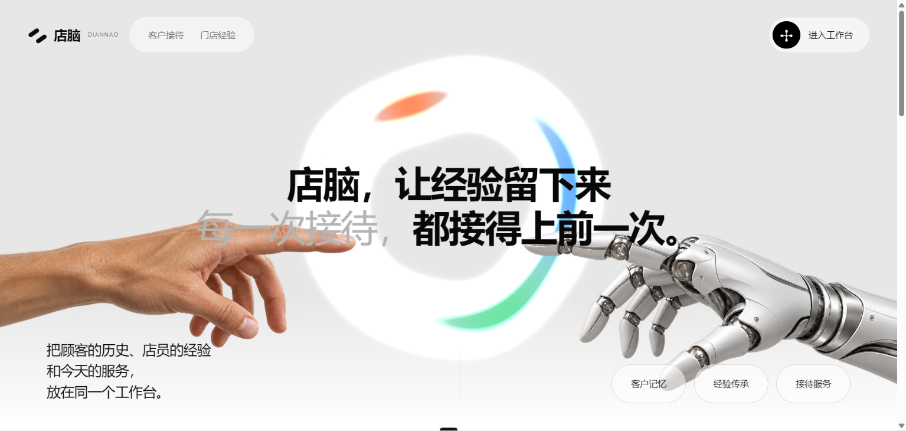
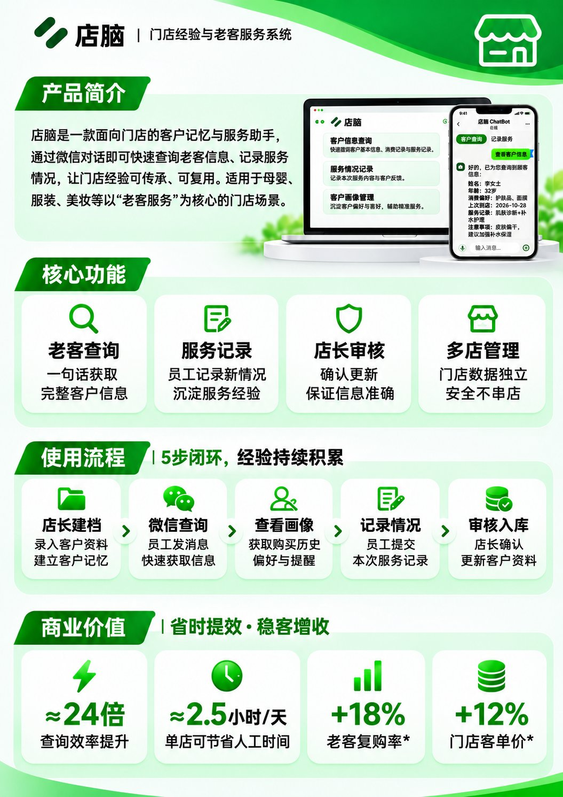
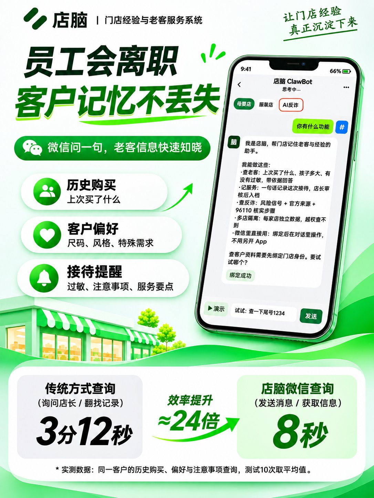
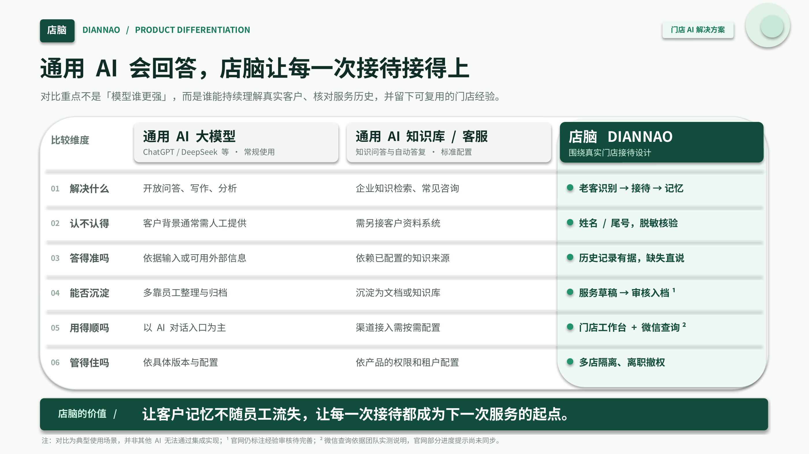
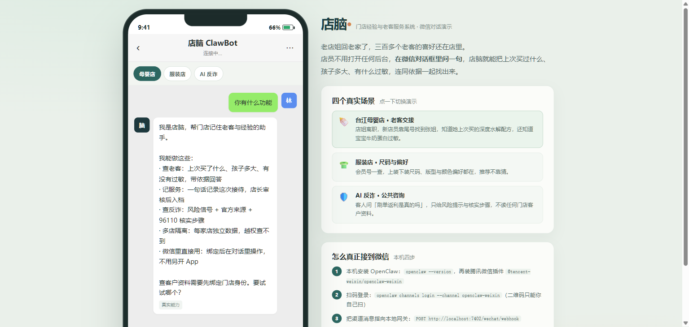
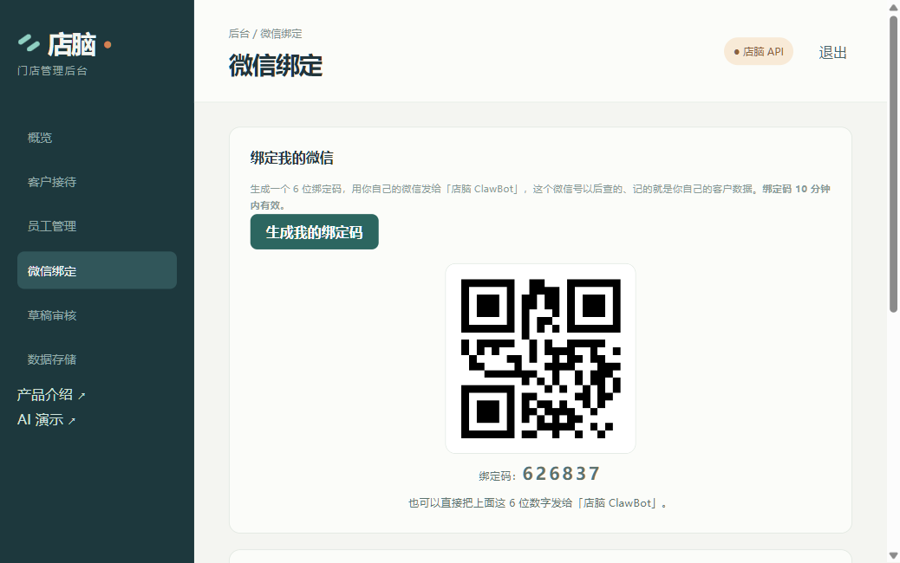
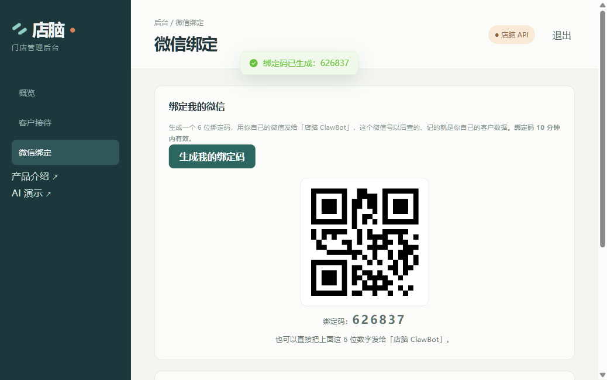
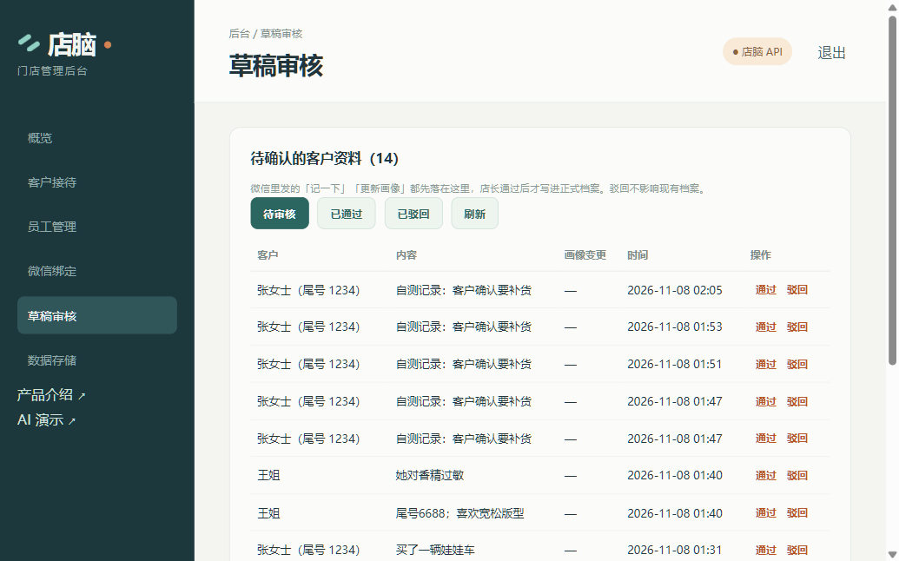
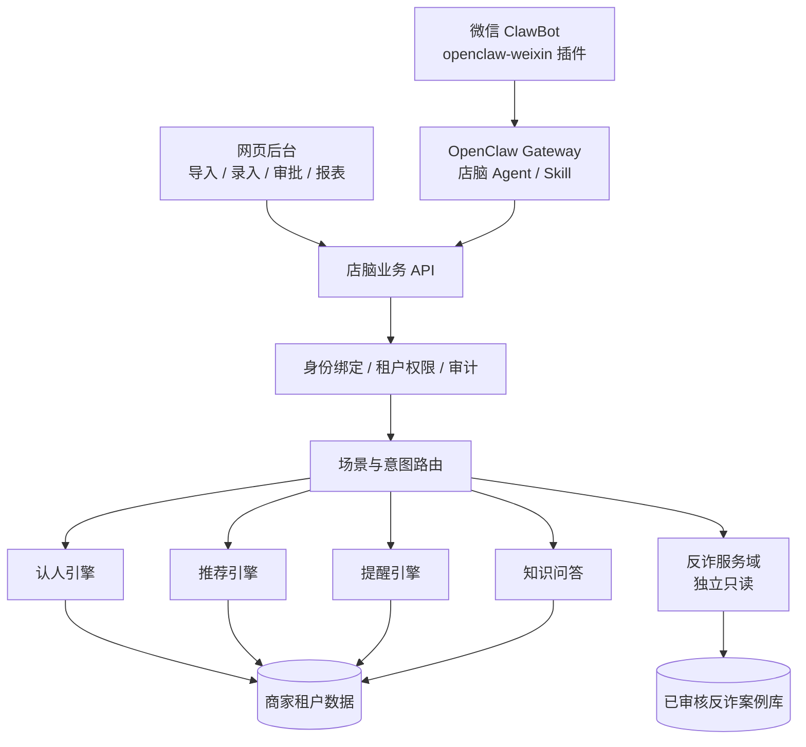

# 店脑 DIANNAO

> **福州黑客松参赛项目** · 门店经验与老客服务系统

**员工会离职，客户记忆不该跟着丢。**

把散落在店员脑子里的客户记忆、商品资料和服务经验，变成门店可追溯、可交接、可撤权的数据资产；让 AI 在微信里替店员「认出这个人」。



---

## 一句话

**店脑，让经验留下来；每一次接待，都接得上前一次。**

老店的价值不在货架，而在「谁来过、买过什么、孩子多大、对什么过敏」这些只存在于店员脑子里的信息。店员一换、老客一进门，这些经验就断了。店脑把这些记忆沉淀成带来源、可审核、可撤权的门店数据资产。

## 产品一页纸



## 为什么做这个



| 现状 | 后果 |
|---|---|
| 老客资料记在店员脑子里、微信聊天记录里、纸质本子上 | 店员离职即失忆，老客体验断档 |
| 资深店员的判断无法复制 | 新人上手慢，推荐全靠猜 |
| 客户资料散落、无授权边界 | 谁都能看，出了事查不到 |
| 老年顾客易被诈骗，店员不敢多嘴 | 该提醒的时候没人敢提醒 |

店脑的答案：**一套行业无关的核心引擎 + 多个行业配置包 + 两条相互隔离的服务域 + 两种入口（网页后台 / 微信 ClawBot）**。

## 和通用 AI 有什么不同



比拼的不是「模型谁更强」，而是**谁能持续理解真实客户、核对服务历史，并留下可复用的门店经验**：

- 通用 AI 需要你先把客户背景喂给它；店脑**先认人再答题**，姓名/尾号脱敏核验。
- 通用 AI 依赖你上传的知识库；店脑的事实来自**门店自己的服务历史**，没记录就直说没有。
- 通用 AI 的对话用完即散；店脑的每次接待会沉淀成**草稿 → 店长审核 → 正式档案**。
- 通用 AI 不区分租户；店脑**多店隔离、离职即撤权**，旧 token 立即失效。

## 产品截图

### 微信里的店员助手

店员不用装 App，在微信对话里问一句，店脑就把上次买过什么、孩子多大、有什么过敏，连同依据一起找出来。



### 后台：微信绑定

生成 6 位绑定码，店员用自己的微信发给「店脑 ClawBot」，此后这个微信号查的、记的都是他自己的门店数据。



店员侧看到的绑定说明与调用入口：



### 后台：草稿审核

微信里发「记一下」「更新画像」不会直接改档案，先落到待审核区，店长通过后才写入正式档案，驳回不影响现有数据。



## 核心能力

- **认人**：确定性索引优先 + 候选消歧，先认人再答题；查不到就说「当前没有相关记录」，不编造。
- **经验传承**：微信一句话录入 → 草稿区 → 店长审核 → 正式档案，全程留来源与操作人。
- **接待服务**：基于硬规则过滤 + 商品/经验召回，推荐必须给得出可追溯的解释。
- **反诈（独立域）**：只读官方审核案例库（96110 等来源），**不读取任何商家客户资料**，与商家服务域物理隔离。
- **多租户隔离**：每店数据独立，B 店访问 A 店一律 404；撤权后旧 token **立即** 401。
- **可导出、可撤权、可审计**：数据归店，导入导出走审计，6 类关键动作可查。

## 架构



三条机制**不可混用**：认人靠确定性索引，推荐靠硬规则 + 检索，提醒靠时间/事件规则。AI 只负责理解和措辞，事实必须来自数据。

## 技术栈

| 层 | 选型 |
|---|---|
| 网页后台 | Vue 3 + Vite 7 + Element Plus |
| 业务 API | TypeScript + Node.js（零依赖 HTTP/CSV 实现） |
| 数据 | SQLite（演示）→ PostgreSQL（7 个有序迁移脚本已备） |
| 微信渠道 | openclaw-weixin 插件 + Gateway + 受控 Skill |
| 端到端测试 | Playwright |
| AI | 规则简版 + 可插拔模型（演示阶段不接真实模型） |

## 目录结构

```text
.
├── diannao/                  # 主工程
│   ├── apps/web/             #   Vue 3 网页后台
│   ├── services/api/         #   业务 API（18 端点）
│   ├── services/ai/          #   AI 引擎与评测
│   ├── adapters/wechat/      #   微信 ClawBot 适配器 + Skill
│   ├── db/migrations/        #   0001~0007 数据库迁移
│   ├── packages/contracts/   #   唯一真相：类型 + Mock
│   ├── tests/e2e/            #   Playwright 用例
│   ├── deploy/               #   服务器安装与部署脚本
│   ├── docs/                 #   部署、容量评估、验收标准
│   └── 页面/                 #   独立落地页（可直接打开 index.html）
├── 产品方案/                  # 产品方案、PRD、接口契约、库表草案
└── docs/screenshots/         # README 图片
```

## 快速开始

需要 Node.js 18+。

```bash
cd diannao
npm install

# 编译并启动 API（默认 http://localhost:7401）
npm run api

# 端到端验证：自动起停干净服务，可重复跑
npm run test:api          # 79 passed / 0 failed
```

网页后台：

```bash
cd diannao/apps/web
npm install
npm run dev               # Vite 开发服务器
```

不想装依赖也可以直接双击 `diannao/页面/index.html` 看落地页。

演示账号（密码由环境变量 `DIANNAO_DEMO_PASSWORD` 提供，未设置时为占位口令）：

| 账号 | 角色 | 用途 |
|---|---|---|
| `diannaoxy` | 店长 | 母婴店全流程 |
| `staff-a` | 店员 | A 店，用于撤权验证 |
| `staff-b` | 店员 | B 店，用于跨租户隔离验证 |
| `cloth-demo` | 店员 | 服装店场景 |

## 数据与安全

本仓库**不含**任何真实凭据。发布前已做以下剔除与清洗：

- 移除 `runtime/openclaw/.env`（含真实模型 API Key）
- 移除 `data/provision.key`、`data/diannao.db`（真实演示库）
- 移除 `adapters/wechat/users.json`（含明文口令）
- 移除两张微信登录二维码 PNG
- 代码中原先硬编码的演示口令统一改为读取环境变量
- 提供 `.env.example` 与 `users.example.json` 作为模板

> 反诈域的官方案例均标注来源并经过审核流程，仅作风险提示，不替代警方判断。

## 关于宣传图中的指标

宣传图里的 **≈24 倍查询效率提升**、**≈2.5 小时/天**、**+18% 复购率**、**+12% 客单价**，来自团队在演示门店场景下的小样本实测与估算，**不是第三方审计数据**，仅用于说明产品方向，不作为效果承诺。

## 现状与限制（如实标注）

- 数据在内存中，重启即重置；PostgreSQL 迁移脚本已备但未执行。
- 会话 token 为简化实现，非完整 JWT 签名（租户隔离、撤权、版本校验逻辑完整）。
- AI 问答为规则简版，未接真实模型与向量检索。
- 微信插件在真实公众号环境下尚未完成验证，核心业务以网页后台演示为准。
- 截图中的客户姓名、商品与门店均为虚构演示数据。

## 参赛说明

本项目为**福州黑客松**参赛作品，由五人小队在极短时间内完成从产品方案到可运行原型的闭环。

| 角色 | 负责域 |
|---|---|
| 队长 | 产品范围、试点、验收、进度仲裁 |
| 架构 | 架构、数据、契约、API、迁移 |
| 前端 | 网页与交互体验 |
| AI | AI、知识、规则、评测 |
| 工程 | 渠道、测试、环境、发布与恢复 |

## 许可

本仓库为参赛与演示用途开源。第三方素材（字体、图标、示例图片）版权归原作者所有，商用前请自行替换。
