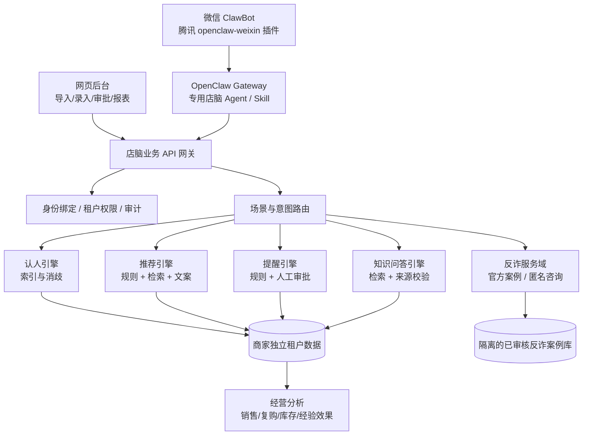

# 店脑 AI · 统一产品方案与 PRD（V2.0）

> 日期：2026-11-07｜状态：方案整合定稿 / 工程接口待部署｜入口：网页工作台 + 微信 ClawBot
>
> 本文综合《05-统一架构产品方案》《2026-11-07_回复》《PRD》《产品方案》《功能主干规格》《黑客松产品方案》六份资料，保留原有功能并消除冲突。

## 一、产品决策（统一口径）

**一句话定位**：将线下门店分散的客户记忆、商品资料、服务历史和资深员工经验沉淀为可追溯的数据资产，让 AI Agent 在微信或网页中完成认人、查询、推荐、提醒草拟与经营复盘；高风险动作由人审核。

产品不是四套行业 App，也不是仅能聊天的机器人。采用“一套行业无关的核心引擎 + 多个行业配置包 + 两条隔离的服务域 + 两种入口”。

- **商业服务域（私有）**：客户、关联对象、交易/服务记录、商品知识、员工经验、推荐、提醒与销售分析；以商家/门店数据权限为边界。
- **公共反诈服务域（独立）**：审核通过的官方反诈案例库、风险识别和核实建议；不读取任何商家内部客户资料。
- **入口**：网页管理后台用于管理、录入和审批；微信 ClawBot 用于店员即时查询、轻量录入和经授权的咨询。微信是接入渠道，不是数据库本体。
- **首发顺序**：母婴店跑通全闭环（P0）；防诈骗做独立只读演示流程（P0-lite）；服装、汽修支持可配置字段与查询（P1）；医美作为新增模板（P2）；药店/慢病风险管理另行评估后上线（P3）。
- **首版不做**：3D 货架、未经授权的群发营销、直接自动收款、AI 医疗诊断、自动承诺维修结果、无审核地改写关键客户事实。

## 二、统一架构



**三条机制不可混用**：认人=确定性索引优先+候选消歧；推荐=硬规则过滤+商品/经验召回+可追溯的自然语言解释；提醒=时间/事件规则驱动，AI 仅草拟文案、任务由系统调度并依渠道能力发送。AI 不能靠猜测“补足”不存在的事实。

**业务流程**：门店旧数据导入/店员轻量采集 → 识别主体 → 写入带来源的事实或草稿 → 审核/冲突处理 → 认人/推荐/提醒 → 店员接待或审批 → 交易/反馈回流 → 经营分析和经验效果复盘。

## 三、统一功能主干（保留原方案全部核心能力）

| 模块 | P0 最小可用功能 | P1/P2 保留扩展 | 交互入口 |
|---|---|---|---|
| M01 行业配置层 | 行业字段、术语、规则、卡片配置，版本管理 | 可视化配置编辑器和模板商店 | 网页 |
| M02 客户与对象记忆 | 系统 ID、别名/识别线索、关系、偏好、事实来源、历史时间线 | 客户分群、生命周期、情感标签需核实 | 网页 / 微信 |
| M03 交易与服务记录 | 购买/服务/工单、数量金额、时间和来源 | POS/API 同步、退换货、评价 | 网页 / 微信轻量补录 |
| M04 商品/服务知识库 | SKU、适用条件、价格版本、库存、货架文本位置 | 促销、低库存、进货辅助、报价对比 | 网页 / 微信 |
| M05 经验传承库 | 老员工口述转草稿、适用条件、做法、禁忌、审核发布 | 销冠话术 A/B、效果反馈、过时下架 | 网页 / 微信 |
| M06 AI 检索问答 | 认人消歧、来源引用、缺失和冲突提示 | 图片识别、语音转写、更多行业意图 | 网页 / 微信 |
| M07 智能推荐 | 规则筛选+召回+推荐理由+禁忌过滤，默认给店员 | 可发文案、推荐状态、转化归因 | 网页 / 微信 |
| M08 提醒与跟进 | 生日/补货/换段/保养/上新任务、冷却、审批 | 经授权的客户主动触达与回执 | 网页为主 / 微信受限 |
| M09 经营分析 | 日周月营业额、订单、客单价、TOP SKU、客户复购 | 商品趋势、库存预测、话术命中率 | 网页 / 微信摘要 |
| M10 组织与权限 | 商家/门店/员工、实名绑定、角色权限、离职撤权 | 连锁总部、多门店跨店授权 | 网页 |
| M11 运营与导入导出 | Excel/CSV 映射导入、去重、审计、导出 | 自动收银对接、批处理 | 网页 |
| M12 公共反诈 | 官方案例审核、文本咨询、特征与核验建议 | 图/语音解析、门店白名单核验（仅授权） | 独立微信 Agent / 网页 |

### 3.1 经验沉淀关键闭环

每条经验必须记录：`标题 → 适用场景 → 识别条件 → 建议处理步骤 → 不适用情况/风险 → 证据/案例 → 提交人 → 审核状态 → 版本 → 使用/反馈指标`。从店员口述抽取的经验首先进入 **draft**，而不是自动变成事实或规则。店长审核后生效；经验被调用与成交结果关联，复盘“是否真的有效”。

### 3.2 录入要轻，但关键事实要严

一线店员通常在三步内完成：**找人/找对象 → 拍、说、扫或选 → 确认提交**。熟客可用“和上次一样”快捷记录，但系统必须先锚定具体商品/工单，不能把口头表达当成自动下单。语音转写是待确认文本；过敏、健康、车辆安全相关字段必须明确来源并允许人工复核。

### 3.3 四级输出

- **L1** 一句话：高频命中、≤20字的操作摘要。
- **L2** 三行卡片（店员默认）：是谁 / 以前发生什么 / 现在建议做什么。
- **L3** 对客话术草稿：语气可按行业调整，先审后发。
- **L4** 详情结构卡：时间线、证据 ID、冲突点、商品约束和待办。

### 3.4 冷启动策略

门店可导出历史数据，默认 **Excel/CSV 优先**：导出会员/POS/工单 → 字段映射与清洗 → 批量导入 → 用姓名/手机号/会员号等认领 → 店姐口述补充隐性经验 → 抽样核对 → 正式使用。模拟数据用于验收，不混入真实客户库。

## 四、识别、权限及冲突消解

### 4.1 身份与对象主键

- `customer_id` / `subject_id`：系统生成 UUID，**始终是唯一主键**。旧文档中“手机尾号做主键”的方案废止；尾号仅是匹配线索，有撞号且会变更。
- 识别优先：会员码/专属二维码/完整手机号（有合法采集基础）→ 手机尾号+姓名 → 姓名+门店 → 车辆车牌或 VIN（汽修）→ 已绑定微信 ID；昵称不能单独认定身份。
- 命中多个：展示脱敏候选，要求补充信息。未确认之前只给通用建议，不展示全档案。
- 支持“认不出”：新增最小草稿 / 问三个关键问题 / 输出通用经验并写入待匹配队列。

### 4.2 租户与身份隔离

商家数据归商家，不归店员；核心表都带 `tenant_id`，门店记录带 `store_id`。RBAC：平台管理员、店主/总部、店长、店员、只读审计；普通反诈访客不拥有商家域凭证。微信扫码关联 ClawBot **不等于**绑定商家员工。店员要在网页验证账号，并通过一次性绑定码将渠道身份绑定到 staff 角色；服务端每次操作都检验当前角色、商家、门店和数据范围，离职立即失效。手机号、出生日期、健康信息、完整聊天内容和位置等按最小必要原则处理。

### 4.3 事实、推断与证据

事实记录的标准结构：`value + subject_id + attr_key + source_type + source_id + observed_at + verified_by + confidence + version + status`。不丢弃旧值，提供历史溯源。

- 客观交易/库存：以交易记录或经审核的系统记录为准；仍需处理同步时效。
- 客户偏好：客户最新明确表达优于旧推断；多次差异需追问，而非按“店员永远高于客户”。
- 安全/健康/风险：任何自动推断不得覆盖人工已确认的禁忌；来源矛盾需阻断高风险推荐并转人工。
- 关系/授权：需由具备权限的人员确认，不由模型根据聊天猜测。
- 引用规则：**涉及客户事实、价格、库存、交易和推荐理由，必须有可追溯记录**；纯寒暄可不引数据库。无依据则明确“暂无相关记录”。

## 五、行业配置包（一个引擎、多场景）

| 场景 | 主题对象/关键字段 | 核心规则 | 不自动回答的边界 | 优先级 |
|---|---|---|---|---|
| **母婴** | 家庭/宝宝、出生日期、常买 SKU、奶粉段位、纸尿裤尺码、过敏禁忌 | 月龄派生、补货预测、换段提醒、会员生日、到货 | 医疗/喂养诊断、过敏风险替代判断、价格承诺 | P0 完整闭环 |
| **服装** | 顾客、上下装/鞋码、版型/颜色偏好、退货/代购 | 尺码验证、换季上新、同款补货、生日 | 身材价值判断、未知尺码的保证、虚构库存 | P1 |
| **汽修** | 车主-车辆、车牌/VIN、里程、工单、换件、保修 | 保养周期、年检、保险、报价差异提示、预约 | 故障确诊、工单外报价/保修承诺、事故责任 | P1 |
| **医美** | 客户、已发生服务项目、时间、服务反馈、随访记录 | 到期随访、服务资料查询、复购咨询草稿 | 医疗诊断、效果保证、治疗建议、敏感病史自动推送 | P2 |
| **药店/关怀** | 经授权顾客/家属、药品/服务记录、人工核实风险信息 | 复诊提示、购药异常、风险咨询转人工 | AI 用药建议、自动医学判断、未经授权向家属透露健康信息 | P3 |
| **公共反诈** | 可疑消息/账号、官方案例、风险信号、核实步骤 | 关键词+结构化信号+案例检索；命中红线优先安全建议 | 直接认定犯罪、索要支付密码/验证码、读取商家客户档案 | P0-lite |

**配置字段**：`scene_id, subject_types, field_schema, capture_flow, rules, templates, human_handoff, acceptance_tests, version`。行业差异优先通过 JSON Schema / JSONB 与规则表承载；特殊行业监管、工作流、计价或工单处理仍允许有行业插件，不能承诺“永远一行代码不变”。

### 5.1 母婴一条完整业务链（首发示例）

店姐问“手机号后四位 1234 的张姐上次那款纸尿裤还有吗？” → 后端校验店姐身份 → 搜索候选、确认客户 → 读取最近订单 SKU/尺码 + 当前库存及更新时间 → 输出“上次购买 XXX、规格 Y；库存 Z（更新于…）；建议回问尺码是否变化” → 生成待发话术 → 店姐确认发送 → 订单/反馈回写。若存在过敏或月龄禁忌，只提示“需人工核对”，不让大模型自主判断医疗安全。

### 5.2 防诈骗演示链路

用户描述“对方让我先刷单转钱才给返利” → 公共反诈 Agent 读取对话中用户主动提交的信息 → 抽取转账/收益/紧迫等信号 → 检索已审核的官方“刷单返利”案例 → 输出风险提示、吻合特征、官方来源与三步核实建议。**未命中案例不等于安全**。如称已转账，优先建议立即停止付款、保留证据、联系银行及警方/官方反诈渠道。防诈与门店客户画像零数据连通。

## 六、微信 ClawBot 接入（正式方案）

### 6.1 已确认的技术能力与限制

按 2026-11-07 的腾讯仓库及 OpenClaw 文档，**微信 ClawBot 是 Tencent 维护的外部渠道插件** `@tencent-weixin/openclaw-weixin`，渠道 ID 为 `openclaw-weixin`。支持扫码登录和私聊消息收发，插件列明文本、图片、语音、文件、视频等消息类型；**未宣布支持普通微信群聊**，因此首版不规划“群里 @ 机器人自动接待”。

官方渠道插件与旧方案中的 `wcferry/逆向个人号/三号轮换` 不是同一种方案。本版优先官方渠道，旧的逆向/轮换方案不纳入交付。**能对话 ≠ 能任意向所有个人微信好友群发**：主动发送能力、上下文 token、目标可达性和营销规则必须逐项实测，不能保证批量触达。

重要版本风险：OpenClaw 当前渠道文档指出其描述的腾讯插件 `2.4.8` 版本配对实现存在局限，标准 pairing 命令可能无法生效。因此绝不能仅凭微信配对把商家数据库开放出去；必须使用独立鉴权、最小权限 Agent/API。应按安装时的实际版本复核，不把文档中的版本视为用户本机已安装版本。

参考：
- https://docs.openclaw.ai/channels/wechat
- https://github.com/Tencent/openclaw-weixin
- https://docs.openclaw.ai/tools/skills

### 6.2 安装与通道验证（需要在用户自己的 OpenClaw 环境操作）

```bash
# 先确认本机已安装 OpenClaw，且 Node.js / 版本满足插件要求
openclaw --version
node --version

# 腾讯维护的渠道插件安装方式
npx -y @tencent-weixin/openclaw-weixin-cli install
# 若未自动启用：
openclaw config set plugins.entries.openclaw-weixin.enabled true

# 在 Gateway 所在机器扫码绑定
openclaw channels login --channel openclaw-weixin

# 重启与核验
openclaw gateway restart
openclaw plugins list
openclaw channels status --probe

# 多微信账号部署建议的会话隔离设置（影响全局频道）
openclaw config set session.dmScope per-account-channel-peer
```

扫码验证只完成微信通信；**不是店脑后端接入完成**。要让机器人查客户，需要再配置“店脑业务 API + 专用 Skill/Tool + 服务端身份绑定”。

### 6.3 推荐连接方式：专用业务 API，而非聊天机器人直连数据库

```text
微信私聊 → 腾讯插件 → OpenClaw 店脑 Agent
    → 固定业务 Tool/Skill（仅调用店脑受控 API）
    → 店脑服务端鉴权、租户/门店校验
    → 记忆/商品/经验/推荐/提醒服务
    → 返回有证据和可操作状态的业务结果
    → OpenClaw 按规则整理简短回复 → 微信
```

- **演示单店**：只绑定店主/店员内部账号；OpenClaw Skill 使用受限的服务端凭证（只读或草稿权限），API 以凭证映射角色和商家，拒绝使用模型传来的 `tenant_id/role` 作为授权事实。
- **正式多店**：单独的可信消息适配器从已验证的通道元数据取得 `channel + account_id + peer_id`，服务端签发短时身份上下文；由业务 API 将其映射到用户。不能信任用户消息文本里自称的“我是店长”。
- **普通用户反诈**：使用独立 Agent、独立 API Key 和仅能访问公开已审核案例的服务，不能共享商家查询的工具权限。
- **对外客户咨询**：仅可查公开商品/营业信息，未授权时不得查询任何其他人的购买记录或私密偏好。

### 6.4 设计接口（业务 API，不冒充腾讯官方接口）

| 方法 / 路由 | 功能 | 服务端权限 | 约束 |
|---|---|---|---|
| `POST /v1/assistant/ask` | 私有商家问答 | 已认证店员/店长 | 先查权限、再检索与引用 |
| `POST /v1/identity/resolve` | 身份候选查询 | 本店店员 | 重名/尾号冲突仅回脱敏候选 |
| `POST /v1/notes/drafts` | 语音/文字轻量录入 | 本店店员 | 只能创建草稿，不能直接覆盖安全字段 |
| `POST /v1/notes/{id}/approve` | 审批草稿/经验 | 店长/管理员 | 版本与审计 |
| `POST /v1/recommendations` | 带依据推荐 | 本店店员 | 禁忌优先、无依据不推荐 |
| `GET /v1/reminders` | 查询到期提醒 | 本店店员 | 按门店与审批状态 |
| `POST /v1/reminders/{id}/approve` | 批准对客提醒草稿 | 店长/授权人 | 仅批准，不等于已成功发送 |
| `POST /v1/antifraud/assess` | 公开反诈咨询 | 公共受限调用者 | 不接触商家数据 |
| `GET /v1/reports/overview` | 销售数据摘要 | 店长/店主 | 真实统计口径与时间范围 |
| `POST /v1/imports/preview` | Excel/CSV 预检 | 管理员 | 导入前去重与校验 |

建议统一返回 `status, answer, evidence[], candidates[], needs_confirmation, handoff, actions[], trace_id`，返回 `evidence[]` 的源 ID、发生时间与更新时间。具体字段见随附 API 规格文件。

### 6.5 识别与回复决策

1. **接收消息**：标准化消息 ID、时间、会话类型、媒体类型；按消息 ID 幂等处理。
2. **身份校验**：若访问商家资料，必须先满足绑定和角色；未绑定返回绑定引导，不猜客户数据。
3. **意图分类**：客户查询、服务查询、价格库存、推荐、笔记录入、提醒、报表、反诈、投诉/高风险。
4. **路由**：反诈走公共域；内部店员走商家域；普通来客只走公开商品域。
5. **认人**：多候选须确认、无法查到则不编造。
6. **提取/检索/规则**：优先结构化数据；推荐必须通过硬约束（适用条件、禁忌、库存有效期）。
7. **决策**：正常低风险查询自动回；价格/安全/投诉/定单等高风险仅草稿或转人工。
8. **回复**：L2 三行结构，明确依据、更新时间与不确定点；记录审计和性能指标。
9. **写入**：客户资料更新、经验升级、跨门店共享等动作须独立授权；不能从对话暗中自动提交。

**出站消息状态**：`draft → approved → queued → sent/failed/expired`。即使提醒规则触发，也必须先满足客户授权、渠道允许、频控、可达性和人审策略；失败保存任务，不默认为已发送。

## 七、数据模型：从“九张表”升级到可运营结构

原方案“九张表”足以描述记忆概念，但无法完整承载多租户、审批、库存、报价、权限、导入导出、销售报表和审计。为避免后续推翻主干，建议按域划分表：

| 域 | 建议逻辑表 | 作用 |
|---|---|---|
| 租户/权限 | `tenants, stores, users, memberships, channel_bindings` | 商家与员工、店员微信绑定 |
| 客户/记忆 | `subjects, subject_relations, attributes, identity_keys` | 人/宝宝/车辆等、记忆与证据 |
| 业务交易 | `products, inventory_snapshots, transactions, transaction_lines, service_events` | 商品、购买、服务、工单 |
| 知识/经验 | `knowledge_entries, knowledge_versions, evidence_links` | 审核版本和引用 |
| AI 任务 | `recommendations, reminder_rules, reminder_tasks, interaction_events, message_events` | 推荐、提醒、触达和消息历史 |
| 公共反诈 | `fraud_cases, fraud_signals, fraud_case_sources` | 审核后的独立官方案例域 |
| 治理 | `imports, export_jobs, audit_logs, config_versions` | 审计、归属、场景版本 |

实现上可用 PostgreSQL（含 JSONB 与向量检索作为后续增强）。多租户 `tenant_id` 设成数据库层隔离约束；同时配合应用授权/数据库 RLS。行业特有字段存入 JSONB 并经配置 Schema 校验，常用识别键/时间/tenant 建索引。敏感字段可独立加密并设置保存期限。附带的简化 SQL 仅为核心表骨架，不是完整生产迁移脚本。

## 八、网页工作台：非技术用户也能使用

建议九类页面按角色显示：①工作台总览 ②客户/对象档案 ③商品与服务 ④交易记录/导入 ⑤经验草稿与审核 ⑥AI 问答与推荐 ⑦提醒与触达审批 ⑧经营看板 ⑨权限、审计、配置与导出。平台管理员另有“反诈案例管理”入口。手机屏和电脑都可操作。日常操作必须可通过界面完成，不要求店员编写配置或使用 OpenClaw 命令。

## 九、MVP 拆分与验收

| 阶段 | 交付内容 | 验收重点 |
|---|---|---|
| **V0：离线验真/原型** | 200 名模拟客户、80 SKU、3 个月订单样本；4 行业数据模板；网页可点击流程 | 数据不串、字段配置可切换、尾号冲突能处理 |
| **V1：母婴业务闭环** | 数据库、身份与角色、CSV 导入、档案/商品/订单、经验审核、认人和推荐、基础销售报表 | 查询有源、库存约束、经验可审核/撤回 |
| **V1.1：微信 ClawBot** | 腾讯插件扫码、专用 Agent/Skill、店员绑定、只读问答、草稿录入、失败可重试 | 角色隔离、私聊通道、消息幂等、未绑定拒绝 |
| **V1.2：提醒与回流** | 规则触发、审批工作流、发送状态、复购/转化回流 | 未授权不发、发送失败有回执、频控有效 |
| **V1.3：公共反诈** | 独立服务、官方审核案例、基础咨询、审计 | 不能访问商家数据；输出风险信号和来源 |
| **V2：行业复制** | 服装、汽修完整链路；医美模板原型 | 同引擎切换配置，仅增业务专属工作流 |

### 9.1 可测的建议验收指标（非既有实测数据）

1. 跨租户读取/写入测试：**0 次允许越权**（硬门槛）。
2. 有明确身份歧义的测试：**100% 先确认，不泄露客户细节**。
3. 客户事实、价格、库存相关回答：**100% 提供证据 ID 或明确“无记录”**。
4. 安全字段冲突：**100% 阻断自动推荐与更改并进入人工核实**。
5. 消息重复投递：**同一 `message_id` 不重复入库/重复下发**。
6. 提醒审批/渠道失败：**未审批不触达；失败状态留痕，不能冒充发送成功**。
7. 防诈公开接口：**100% 不能访问商家内部 API/字段**。
8. 录入体验：**主要路径 ≤3 个用户动作**；耗时应在试点店用真实任务测量。
9. 推荐/销售转化率、续费率、店员使用意愿等：先测基线再设目标，不编造。

## 十、取舍记录：六方案冲突如何处理

| 争议 | 不一致的原方案 | 本版决策 |
|---|---|---|
| 多少产品 | 四个行业 App / 一套配置平台 | **一套核心、行业配置包、公共反诈隔离** |
| 防诈骗位置 | 母婴/药店的一条分支 / 公共服务 / 远期产品 | **独立反诈服务域，先演示只读，不挤占母婴主线** |
| 首发范围 | 母婴一行业 / 四行业同时 / 母婴+反诈 | **母婴闭环首发，反诈轻量并行，其他先配模板** |
| 客户主键 | 手机尾号 / 系统生成 ID | **UUID 为主键，手机号只是索引/识别线索** |
| 核心存储 | 九张表 / 六实体 / 大三库 | **逻辑领域统一，落库按权限和功能扩展** |
| AI 角色 | 全自动销售 / AI 辅助 / 非生成规则 | **规则决策确定性，AI 整理与建议；高风险人审** |
| 微信方式 | 企微优先 / 逆向个人号 / 官方 ClawBot | **官方 Tencent 插件优先；企微备用；不使用逆向轮换** |
| 消息能力 | 群聊@、朋友圈、主动群发 | **私聊优先；群聊/名片/主动发送等必须验证，不作为 V1 承诺** |
| 价格 | 固定 ¥99/299 / 未定 | **先不设未经验证的定价；保留单店/连锁按席位订阅模型** |
| 医美/药店 | 场景名单不同 | **保留为未来独立行业模板；监管与敏感数据规则加严** |

## 十一、商业化与运营

以订阅为主，建议保留三层计费结构但暂不固定价格：体验版（数据/功能额度限制）、单店版（基础 CRM、知识库、AI 询问、报表、有限提醒）、连锁版（多门店、总部模板、审计、独立实例或统一治理）。按门店数、员工席位、月 AI 调用量与数据容量计费；渠道收费、LLM token、存储和合规成本独立核算。旧文档中的 ¥99 / ¥299 仅作为待验证的假设，不作为已经确认的定价。

## 十二、上线门禁与剩余待落实事项

### 必须完成的门禁

- 微信扫码/版本/私聊收发/图片语音实际验证，**不推定**支持名片、群聊、主动群发。
- 为 ClawBot Agent 使用独立业务密钥，后端校验绑定身份、租户和门店，审计所有客户数据查询。
- 防诈使用独立接口密钥且与内部数据隔离；官方案例由平台管理员审核发布。
- 完成客户告知、访问控制、数据删除/导出流程；医疗/过敏/老年风险等敏感信息仅在明确目的和合法依据下采集。
- 营销触达需要合法授权及渠道允许；默认**仅生成提醒给店员**，不自动向顾客发送。

### 尚需接入环境才可完成的事情

目前尚无用户本机 OpenClaw 运行环境、已登录微信 ClawBot、正式数据库、服务端域名/API 密钥或真实商家数据，因此**本文和附带文件是可实施的产品/接口/Skill 设计，不等于已经替用户完成微信扫码或线上部署**。正式联通需由用户在自己环境执行官方安装、扫码，并让工程服务部署业务 API 与 Skill。

## 附录：源方案功能对照

- `05-统一架构产品方案(1).md`：认人/推荐/提醒机制、统一数据与四配置包、溯源、冲突处理。
- `2026-11-07_回复.md`：轻量采集、导购经验传承、话术效果验证、AI 主执行/人柔性执行。
- `PRD.md`：多角色权限、可追溯问答、公共反诈案例、医美模板、网页页签与验收。
- `产品方案.md`：母婴闭环、客户/商品/销售三系统、L2 数据导入、订阅、阶段验真。
- `功能主干规格.md`：可配置字段、客户 360°、商品与库存、经营指标、推荐与提醒、网页工作台。
- `黑客松产品方案.md`：三步录入、四级输出、冷启动导入、导出归店、公共反诈官方来源、ClawBot 公共模板和场景差异。

**本版核心判断：保留业务能力，但不要让产品成败绑死在微信某项未确认的插件能力上。微信是高频入口，数据和业务引擎才是可持续资产。**
